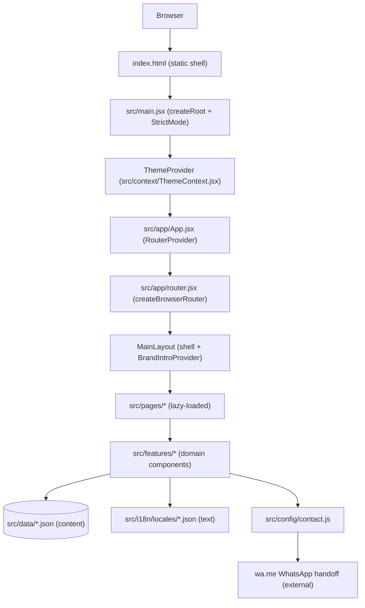
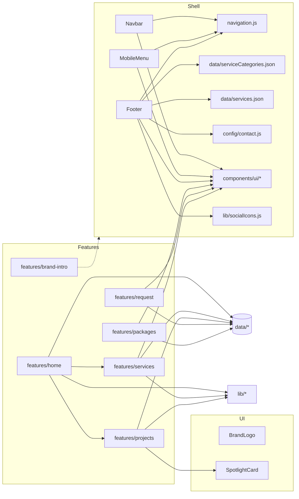
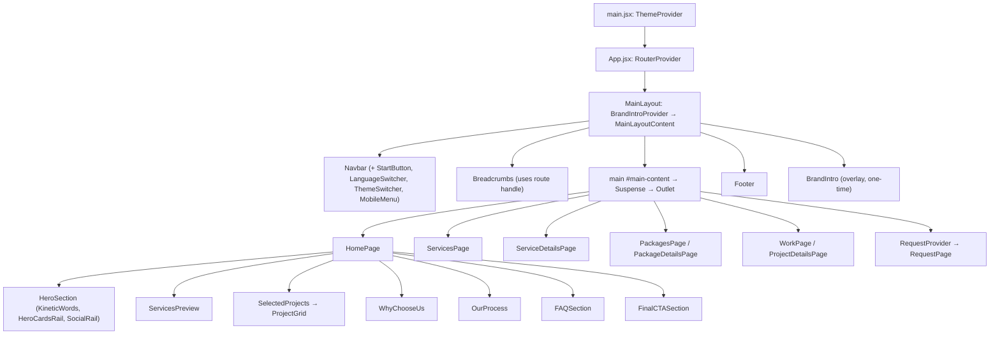
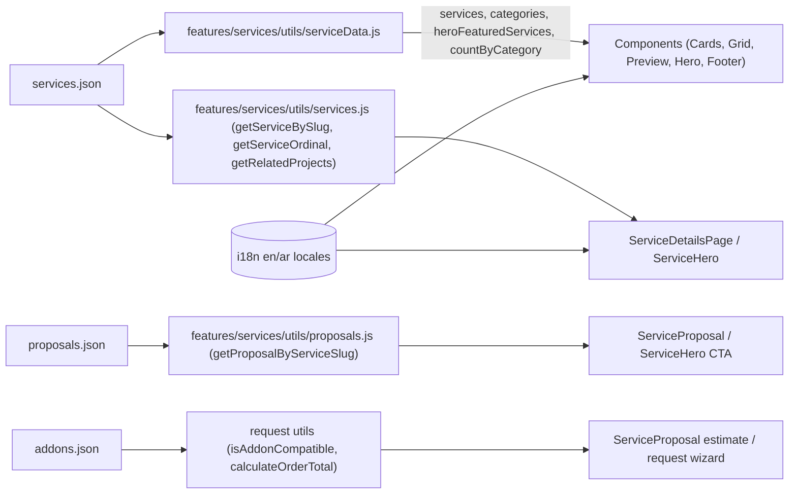
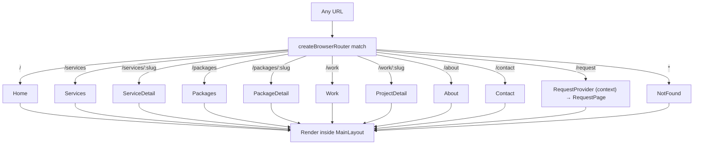
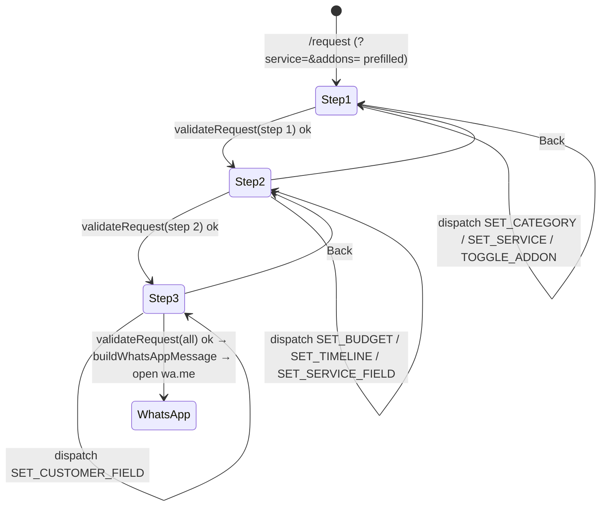

# Helaly — Project Documentation

Complete technical reference for the Helaly front-end application. Every statement below
is based on the source code in this repository. Where something could not be verified from
the code, it is labelled **could not be verified**.

- [1. Introduction](#1-introduction)
- [2. Technology stack](#2-technology-stack)
- [3. Installation and setup](#3-installation-and-setup)
- [4. Project structure](#4-project-structure)
- [5. Dependencies](#5-dependencies)
- [6. Architecture diagrams](#6-architecture-diagrams)
- [7. Architecture and design patterns](#7-architecture-and-design-patterns)
- [8. Routing and navigation](#8-routing-and-navigation)
- [9. Shared components](#9-shared-components)
- [10. Features](#10-features)
- [11. State management](#11-state-management)
- [12. Data model](#12-data-model)
- [13. Internationalization](#13-internationalization)
- [14. Styling and design system](#14-styling-and-design-system)
- [15. Build & Deployment](#15-build--deployment)
- [16. Testing](#16-testing)
- [17. Unused files and architectural notes](#17-unused-files-and-architectural-notes)
- [18. Verification notes](#18-verification-notes)
- [19. Final report](#19-final-report)

---

## 1. Introduction

Helaly is a bilingual (English / Arabic) marketing website for a web design and digital
marketing studio. It is a **client-side single-page application** (SPA) built on React 19
and Vite 8. There is:

- **no backend, API, database, or authentication** — the repository contains only the
  front-end (`src/`), static assets (`public/`), tests (`tests/`) and configuration;
- **no server-side rendering or prerendering** — HTML is rendered in the browser;
- **no persistence of user data** — the request and package forms build a text message and
  open a `wa.me` (WhatsApp) link; the visitor sends it manually. Customer data stays in
  memory and is never written to storage.

The site's content is **data-driven**: catalogues and copy live in `src/data/*.json`
(structured records with i18n keys) and `src/i18n/locales/*.json` (the actual strings).
Components resolve records + translation keys at render time, so the same component code
serves both languages and all catalogue entries.

### What the application does

| Area                               | Description                                                                                                                          |
| ---------------------------------- | ------------------------------------------------------------------------------------------------------------------------------------ |
| Home (`/`)                         | Hero with animated wordmark rail, "requests" list of featured services, selected projects, why-choose-us, process, FAQ, closing CTA. |
| Services (`/services`)             | Searchable, category-filterable catalogue of 12 services (URL-synced `?category=` and `?q=`).                                        |
| Service detail (`/services/:slug`) | Hero, overview, proposal document, inclusions, process, deliverables, related projects, FAQ, CTA.                                    |
| Packages (`/packages`)             | Fixed-price package catalogue, comparison, FAQ, terms.                                                                               |
| Package detail (`/packages/:slug`) | Package hero, full proposal document, add-on selection, inquiry form (WhatsApp).                                                     |
| Work (`/work`, `/work/:slug`)      | Project grid and case-study pages. **Currently empty** — `projects.json` is `[]`.                                                    |
| About / Contact                    | Placeholder pages.                                                                                                                   |
| Request (`/request`)               | 3-step wizard that produces a WhatsApp message.                                                                                      |
| Brand intro                        | A one-time animated overlay on first visit.                                                                                          |

---

## 2. Technology stack

Runtime and build dependencies are declared in `package.json` (verbatim versions):

| Package                            | Version | Role                                                                    |
| ---------------------------------- | ------- | ----------------------------------------------------------------------- |
| `react`                            | ^19.3.1 | UI library                                                              |
| `react-dom`                        | ^19.3.1 | DOM renderer (`createRoot`)                                             |
| `react-router`                     | ^7.18.5 | Client-side routing (data router)                                       |
| `vite`                             | ^8.3.5  | Dev server and production bundler                                       |
| `@vitejs/plugin-react`             | ^6.1.2  | React fast-refresh / JSX transform                                      |
| `tailwindcss`                      | ^4.3.3  | Utility CSS (v4, CSS-first config)                                      |
| `@tailwindcss/vite`                | ^4.3.3  | Tailwind integration for Vite                                           |
| `motion`                           | ^14.9.0 | Animation (`motion/react`)                                              |
| `i18next`                          | ^26.6.0 | i18n core                                                               |
| `react-i18next`                    | ^17.1.9 | React bindings for i18next                                              |
| `lucide-react`                     | ^1.66.0 | Icon set                                                                |
| `@fontsource-variable/manrope`     | ^5.3.0  | Latin typeface (English)                                                |
| `@fontsource-variable/cairo`       | ^5.3.0  | Arabic typeface                                                         |
| `oxlint`                           | ^1.89.0 | Linter (dev)                                                            |
| `@types/react`, `@types/react-dom` | ^19.3.0 | Editor types only — **the project is plain JavaScript, not TypeScript** |

There is **no test framework dependency**: tests use Node's built-in `node --test`. There is
no state-management library, no HTTP client, no CSS-in-JS library, and no SEO/meta library.

---

## 3. Installation and setup

**Prerequisites:** Node.js and npm. Vite 8 requires Node **20.19+ or 22.12+** (its own
requirement — this repository does not pin a version and has no `engines` field; exact
supported range **could not be verified** from the repo).

```bash
npm install     # install dependencies
npm run dev     # start the dev server (Vite + HMR)
```

Other commands:

```bash
npm run build     # production build → dist/
npm run preview   # serve the built output locally
npm run lint      # oxlint
npm test          # node --test --test-concurrency=1
```

**Environment variables:** none are used. There is no `.env` file, no `import.meta.env`
usage, and no secrets in the repository. Runtime configuration lives in
`src/config/contact.js` and `src/data/*.json`.

---

## 4. Project structure

```text
helaly/
├── public/                                  # static files copied to the build root
│   ├── images/brand/image1.svg              # the only image actually present
│   ├── favicon.svg
│   ├── icons.svg                            # present but unreferenced by src/
│   ├── robots.txt
│   ├── site.webmanifest
│   └── sitemap.xml                          # EMPTY file (0 bytes)
├── src/
│   ├── app/
│   │   ├── App.jsx                          # mounts <RouterProvider>
│   │   ├── router.jsx                       # createBrowserRouter route map
│   │   └── layouts/MainLayout.jsx           # shared shell: navbar, breadcrumbs, footer, brand intro
│   ├── assets/                              # unused default assets (see §17)
│   ├── components/
│   │   ├── brand/BrandLogo.jsx
│   │   ├── layout/
│   │   │   ├── Navbar.jsx
│   │   │   ├── MobileMenu.jsx
│   │   │   ├── Footer.jsx
│   │   │   ├── LanguageSwitcher.jsx
│   │   │   ├── ThemeSwitcher.jsx
│   │   │   └── navigation.js                # NAVIGATION_ITEMS + shared path constants
│   │   └── ui/                              # Accordion, Badge, Breadcrumbs, Button, Checkbox,
│   │                                        # Container, EmptyState, FormField, PagePlaceholder,
│   │                                        # Price, SectionHeading, SelectField, SpotlightCard,
│   │                                        # Startbutton, TextAreaField
│   ├── config/contact.js                    # WhatsApp number, email/phone, social links
│   ├── context/ThemeContext.jsx             # theme provider + useTheme()
│   ├── data/
│   │   ├── services.json                    # 12 services
│   │   ├── serviceCategories.json           # 11 categories, grouped
│   │   ├── proposals.json                   # 12 proposals (4 complete, 8 outline)
│   │   ├── addons.json                      # optional add-ons
│   │   ├── packages.json                    # fixed packages
│   │   ├── requestOptions.json              # project types, currencies, timelines
│   │   ├── packageFieldOptions.json         # option groups for package form selects
│   │   ├── processSteps.json                # the 5 shared process steps
│   │   ├── faqs.js                          # FAQ id → translation keys
│   │   └── projects.json                    # EMPTY array []
│   ├── features/
│   │   ├── brand-intro/                     # BrandIntro, BrandIntroProvider, useBrandIntro, constants
│   │   ├── home/components/                 # homepage sections (see §10.1)
│   │   ├── packages/{components,utils}/     # catalog, pricing, inquiry
│   │   ├── projects/{components,utils}/     # case-study UI + selectors
│   │   ├── request/{components,context,hooks,reducers,utils}/
│   │   └── services/{components,hero,preview,utils}/
│   ├── i18n/
│   │   ├── index.js                         # i18next init + document lang/dir sync
│   │   └── locales/{en.json, ar.json}
│   ├── lib/                                 # readTranslation, getSafeExternalUrl, processSteps,
│   │                                        # Motionpresets, socialIcons
│   ├── pages/                               # route-level modules (see §8)
│   ├── styles/index.css                     # design tokens + Tailwind v4 entry (@theme)
│   └── main.jsx                             # React entry: StrictMode + ThemeProvider + App
├── tests/                                   # node:test suites + fixtures/ + helpers/
├── ARCHITECTURE.md
├── README.md
├── index.html
├── package.json
├── vite.config.js
├── .oxlintrc.json
├── .gitignore
└── eslint.config.js                         # EMPTY file (0 bytes) — not functional
```

### Folder responsibilities

| Path                     | Responsibility                                                                       |
| ------------------------ | ------------------------------------------------------------------------------------ |
| `public/`                | Files served verbatim at the site root.                                              |
| `src/app/`               | Application composition: entry `App`, the route map, and the shared layout.          |
| `src/components/ui/`     | Domain-neutral, reusable visual primitives.                                          |
| `src/components/layout/` | Site chrome (navigation, footer, language/theme switches) and shared path constants. |
| `src/components/brand/`  | Brand identity marks.                                                                |
| `src/config/`            | Global configuration values (currently contact details only).                        |
| `src/context/`           | Application-wide React Context providers (theme).                                    |
| `src/data/`              | The single source of catalogue and content records.                                  |
| `src/features/`          | Self-contained domain areas, each owning its components and logic.                   |
| `src/i18n/`              | i18n runtime setup and the two locale resource files.                                |
| `src/lib/`               | Small, framework-agnostic shared helpers.                                            |
| `src/pages/`             | Route-level composition; pages assemble feature components.                          |
| `src/styles/`            | Global stylesheet and design tokens.                                                 |
| `tests/`                 | Node test suites, fixtures and Vite-based test servers.                              |

---

## 5. Dependencies

### Runtime

| Dependency                                  | What it does                                                                                                                                   | Why it is used                                                                          | Where it is used                                                                           |
| ------------------------------------------- | ---------------------------------------------------------------------------------------------------------------------------------------------- | --------------------------------------------------------------------------------------- | ------------------------------------------------------------------------------------------ |
| **react / react-dom**                       | Component model and DOM rendering.                                                                                                             | The application is written in React 19.                                                 | Everywhere; root render in `src/main.jsx`.                                                 |
| **react-router**                            | Declarative client-side routing with a data router (`createBrowserRouter`), `useParams`, `useSearchParams`, `useMatches`, `ScrollRestoration`. | Multi-page navigation without full reloads; route `handle` metadata drives breadcrumbs. | `src/app/router.jsx`, `MainLayout.jsx`, `Breadcrumbs.jsx`, pages.                          |
| **tailwindcss + @tailwindcss/vite**         | Utility-first CSS. v4 uses a CSS-first config (`@theme inline`).                                                                               | Consistent styling driven by design tokens.                                             | `src/styles/index.css` (`@import "tailwindcss"`, `@theme inline`, `@custom-variant dark`). |
| **motion**                                  | Animation primitives (`motion.div`, `useReducedMotion`, `useScroll`, `useTransform`).                                                          | Scroll reveals and micro-interactions that respect reduced motion.                      | Hero, rails, sections, `lib/Motionpresets.js`, `MainLayout`.                               |
| **i18next + react-i18next**                 | Translation runtime + React hook (`useTranslation`).                                                                                           | Bilingual EN/AR with interpolated strings.                                              | `src/i18n/index.js`; every text-bearing component.                                         |
| **lucide-react**                            | Tree-shakeable SVG icon components.                                                                                                            | Consistent iconography.                                                                 | Navbar, MobileMenu, forms, sections.                                                       |
| **@fontsource-variable/manrope, .../cairo** | Self-hosted variable fonts.                                                                                                                    | No external font CDN; Manrope for English, Cairo for Arabic.                            | Imported in `src/main.jsx`; selected via `html[lang]` in `index.css`.                      |

### Development

| Dependency                         | Purpose                                                                                           |
| ---------------------------------- | ------------------------------------------------------------------------------------------------- |
| **vite**                           | Dev server (HMR) and production bundler.                                                          |
| **@vitejs/plugin-react**           | JSX transform and fast refresh.                                                                   |
| **oxlint**                         | Linting, configured by `.oxlintrc.json` (plugins `react`, `oxc`; `react/rules-of-hooks` = error). |
| **@types/react, @types/react-dom** | Editor IntelliSense only; the code is JavaScript.                                                 |
| **Node's built-in test runner**    | Runs `tests/**/*.test.js` (no framework dependency).                                              |

There is no `.eslintrc`; `eslint.config.js` exists but is an empty file and does not
configure anything.

---

## 6. Architecture diagrams

### 6.1 High-level system architecture



There is no server tier: the build is static files, and the only outbound interaction is
the external WhatsApp link opened in a new tab.

### 6.2 Module relationships



### 6.3 Component hierarchy (shell + homepage)



### 6.4 Data flow — a service record to the UI



Records store **keys** (`titleKey`, `overviewKey`, …), never display text. Components call
`t(key)` / `readTranslation(t, key)` to render the right language, so a record is
language-agnostic.

### 6.5 Routing flow



### 6.6 Request wizard state flow



Authentication and API-communication diagrams are **not applicable**: the app has no auth
and no API calls.

---

## 7. Architecture and design patterns

### 7.1 Layering

1. **Composition layer** — `src/app` (router + layout) and `src/pages` (route modules).
2. **Feature layer** — `src/features/<domain>` owns components, hooks, and logic for one
   domain. Features may consume other features' _utils_ (e.g. `home` imports
   `services/utils/serviceData`).
3. **Shared layer** — `src/components/ui` (primitives), `src/components/layout` (chrome),
   `src/lib` (pure helpers).
4. **Data & content layer** — `src/data` (records) and `src/i18n` (strings).

### 7.2 Patterns used

- **Feature-based organization** — everything for a domain lives under one folder.
- **Data-driven UI / content-as-data** — components are generic; variance comes from JSON
  records + translation keys. Adding a service is a data edit, not a code edit.
- **Container/presentational split** — pages and `RequestConfigurator` hold orchestration;
  feature components are presentational and receive records via props.
- **Provider composition** — `ThemeProvider` (app-wide) → `BrandIntroProvider` (layout-wide)
  → `RequestProvider` (route-scoped).
- **Reducer + Context** for the only multi-step, cross-component workflow (the request wizard).
- **Selector/util functions** — pure functions (`getServiceBySlug`, `getProposalByServiceSlug`,
  `getAdjacentProjects`, `filterServices`) keep lookup/sort logic out of components and are
  unit-tested.
- **Custom hooks** — `useTheme`, `useRequestBuilder`, `useBrandIntro`, and motion helpers in
  `lib/Motionpresets.js`.
- **Progressive enhancement of motion** — `useReducedMotion()` plus `motion-reduce:`
  utilities everywhere animation exists.

### 7.3 State boundaries

| Scope           | Mechanism                                     | Notes                                                                              |
| --------------- | --------------------------------------------- | ---------------------------------------------------------------------------------- |
| Theme           | `ThemeContext` (app-wide)                     | Persisted to `localStorage["helaly-theme"]`; applied via `data-theme` on `<html>`. |
| Brand intro     | `BrandIntroContext` (layout-wide)             | Persisted to `localStorage["helaly_intro_seen"]`.                                  |
| Request wizard  | `RequestContext` (route-scoped to `/request`) | `useReducer`; not persisted.                                                       |
| Language        | i18next (app-wide)                            | Persisted to `localStorage["language"]`.                                           |
| Everything else | Local component state / refs / memo           | —                                                                                  |

### 7.4 Error handling and validation

- **Form validation** is run before advancing/submitting: `validateRequest` (request wizard,
  per-step and full) and `validatePackageInquiry` (package form). Both return
  `{ isValid, errors: [{ field, messageKey }] }`, and messages are translation keys.
- **Boundary validation of external input** lives in `lib/getSafeExternalUrl.js` (only
  `http(s)` URLs reach an `href`) and in the WhatsApp number checks (`/^\d+$/`).
- There is **no global error boundary** and **no try/catch around rendering** (confirmed by
  search). `localStorage` access is wrapped in try/catch where it occurs.
- No 404 _HTTP_ handling exists (SPA): `NotFoundPage` renders for `*` routes but the response
  code depends entirely on the host.

---

## 8. Routing and navigation

The single route tree is defined in `src/app/router.jsx` using `createBrowserRouter`.
All routes render inside `MainLayout`. Pages are **lazy-loaded** with `React.lazy` and
rendered inside a `Suspense` boundary in `MainLayout`.

| Path              | Page component                            | Dynamic | Breadcrumb (`handle`)            |
| ----------------- | ----------------------------------------- | ------- | -------------------------------- |
| `/`               | `HomePage`                                | —       | —                                |
| `/services`       | `ServicesPage`                            | —       | Home › Services                  |
| `/services/:slug` | `ServiceDetailsPage`                      | `slug`  | Home › Services › _record title_ |
| `/packages`       | `PackagesPage`                            | —       | Home › Packages                  |
| `/packages/:slug` | `PackageDetailsPage`                      | `slug`  | Home › Packages › _record name_  |
| `/work`           | `WorkPage`                                | —       | Home › Work                      |
| `/work/:slug`     | `ProjectDetailsPage`                      | `slug`  | Home › Work › _record title_     |
| `/about`          | `AboutPage`                               | —       | Home › About                     |
| `/contact`        | `ContactPage`                             | —       | Home › Contact                   |
| `/request`        | `RequestProvider` → `RequestPage` (index) | —       | Home › Start project             |
| `*`               | `NotFoundPage`                            | —       | —                                |

**Navigation and redirects**

- `NAVIGATION_ITEMS` in `src/components/layout/navigation.js` drives both the desktop
  `Navbar` and the `MobileMenu`. It also exports `SERVICES_PATH` (`/services`),
  `WORK_PATH` (`/work`) and `PROJECT_PATH` (`/request`).
- `ScrollRestoration` (React Router) restores scroll position on navigation.
- **No route guards / access control** exist — every route is public.
- **No redirects** are defined in the router.

**Breadcrumbs**
`src/components/ui/Breadcrumbs.jsx` reads `useMatches()` and each route's `handle.breadcrumb`.
For `resource` breadcrumbs (`service`, `project`, `package`) it looks the record up in the
matching data file by `params.slug`, so the crumb and page title always agree. If the record
is missing it returns `null`.

**Query parameters**

- `/services` reads `?category=` and `?q=` (via `useSearchParams`) and keeps them in sync so
  a filtered view is shareable.
- `/request` reads `?service=<slug>` and `?addons=<id,id>` to prefill the wizard.

---

## 9. Shared components

### 9.1 `src/components/ui/`

| Component             | Responsibility (verified behaviour)                                                                                                                                                                                                     |
| --------------------- | --------------------------------------------------------------------------------------------------------------------------------------------------------------------------------------------------------------------------------------- |
| `Button.jsx`          | Polymorphic (`as`) button/link. Variants: `primary`, `brand`, `secondary`, `outline`, `ghost`; sizes `sm/md/lg`. Neutral-first: the primary fill inverts with the theme (`bg-action text-action-ink`); `brand` is the only accent fill. |
| `Container.jsx`       | Max-width (`1440px`) responsive padding wrapper; polymorphic `as`.                                                                                                                                                                      |
| `SectionHeading.jsx`  | Eyebrow + heading (`h2` by default, polymorphic `as`) + description; RTL resets tracking/leading for Arabic.                                                                                                                            |
| `Badge.jsx`           | Pill label; variants `brand`, `neutral`, `success`, `warning`, `neon`.                                                                                                                                                                  |
| `Price.jsx`           | Formats a currency amount with `Intl.NumberFormat` (`ar-EG` for Arabic, else `en-US`); renders `null` when amount/currency are invalid.                                                                                                 |
| `Accordion.jsx`       | Accessible disclosure list; `allowMultiple`, `defaultOpenIds`; uses `inert` on collapsed panels; animation via `grid-template-rows`.                                                                                                    |
| `Breadcrumbs.jsx`     | Route-driven breadcrumbs (see §8).                                                                                                                                                                                                      |
| `Checkbox.jsx`        | Accessible checkbox with `labelKey`, `descriptionKey`, `errorKey`; wires `aria-describedby`, `aria-invalid`.                                                                                                                            |
| `FormField.jsx`       | Labelled text input with helper text, error message, `required` marker, ARIA association; supports controlled/uncontrolled.                                                                                                             |
| `SelectField.jsx`     | Labelled `<select>` with placeholder, grouped options (`labelKey`), helper + error text, custom chevron.                                                                                                                                |
| `TextAreaField.jsx`   | Labelled `<textarea>` with helper + error text.                                                                                                                                                                                         |
| `EmptyState.jsx`      | Centered empty-state panel with icon, title, description and optional CTA; `role="status"`.                                                                                                                                             |
| `PagePlaceholder.jsx` | Minimal page scaffold rendering a single `h1`; used by About/Contact/NotFound.                                                                                                                                                          |
| `SpotlightCard.jsx`   | Glass card lit by the cursor via CSS variables (`--mx/--my/--px/--py`); static (calm) for touch/keyboard and reduced-motion. Used by `ProjectCard`.                                                                                     |
| `Startbutton.jsx`     | The emphasized "Start project" pill (inverted fill + neon disc that floods on hover/focus). Used in `Navbar`.                                                                                                                           |

### 9.2 `src/components/layout/`

| Component              | Responsibility                                                                                                                                                                                                                          |
| ---------------------- | --------------------------------------------------------------------------------------------------------------------------------------------------------------------------------------------------------------------------------------- |
| `Navbar.jsx`           | Sticky header; transparent at the top, solid on scroll. Renders brand, desktop nav (`NavLink` with a `layoutId` active pill), `ThemeSwitcher`, `LanguageSwitcher`, `StartButton`, and `MobileMenu`.                                     |
| `MobileMenu.jsx`       | Below `xl`, a toggle panel with the same navigation items plus theme/language switches and a start-project button. Focus is moved into the panel on open and returned on close; `Escape` closes it; `inert` when closed.                |
| `Footer.jsx`           | Memoized. Four content groups (quick links, services by category with a featured service each, contact methods, social links) plus a legal band. Data is built once at module load; contact/social entries are filtered out when empty. |
| `LanguageSwitcher.jsx` | Toggles `ar ⇄ en` via `i18n.changeLanguage`.                                                                                                                                                                                            |
| `ThemeSwitcher.jsx`    | Toggles dark/light via `useTheme`; icon + accessible label reflect the target mode.                                                                                                                                                     |
| `navigation.js`        | `NAVIGATION_ITEMS` and shared path constants.                                                                                                                                                                                           |

### 9.3 `src/components/brand/BrandLogo.jsx`

Renders the shared brand mark (`public/images/brand/image1.svg`) as a link to the
home page, trimming the asset's transparent margin in CSS and deepening the mint
on light surfaces for contrast. Accepts `wordmarkRef` and `isWordmarkHidden` so
the brand intro can hand the mark off to the navbar, plus `sizeClassName` to set
the responsive height per placement.

---

## 10. Features

### 10.1 `home`

`HomePage` composes (in order): `HeroSection`, `ServicesPreview`, `SelectedProjects`,
`WhyChooseUs`, `OurProcess`, `FAQSection`, `FinalCTASection`.

| Component              | Responsibility                                                                                                                                                                                                         |
| ---------------------- | ---------------------------------------------------------------------------------------------------------------------------------------------------------------------------------------------------------------------- |
| `HeroSection.jsx`      | The hero: eyebrow, headline with a rotating kinetic word, supporting text, primary CTA, a vertical `SocialRail`, and the `HeroCardsRail`. Owns the single `h1`.                                                        |
| `HeroCardsRail.jsx`    | Draggable horizontal rail of `heroFeaturedServices` hung on a parabolic "string"; pointer/momentum physics, auto-drift paused by `IntersectionObserver`; cards link to `/services/:slug`. Honours reduced motion.      |
| `ServicesPreview.jsx`  | Lists `services.filter(s => s.featured)` as the client's own "request" sentences (`intentKey`), with a hover/focus reveal of `previewDescriptionKey`, a `popular` star, and one "Explore services" CTA to `/services`. |
| `SelectedProjects.jsx` | Section heading + `ProjectGrid` (`limit={3}`, `featuredOnly`, `layout="showcase"`). Renders nothing meaningful while `projects.json` is empty.                                                                         |
| `WhyChooseUs.jsx`      | Four value points (tailored, user-centred, performance, communication) with staggered reveal.                                                                                                                          |
| `OurProcess.jsx`       | Scroll-driven 5-step process (Discover→Plan→Design→Develop→Deliver) with a sticky visual; uses `ORDERED_PROCESS_STEPS` from `lib/processSteps.js`.                                                                     |
| `FAQSection.jsx`       | Home FAQ accordion built from `data/faqs.js`.                                                                                                                                                                          |
| `FinalCTASection.jsx`  | Closing editorial CTA with primary ("Start a project") and secondary ("Explore services") actions.                                                                                                                     |

> **Unused in this folder:** `Heroseal.jsx`, `Heroservicecards.jsx`, `Laptopshowcase.jsx`,
> `Launchsection.jsx`, `Marqueestrip.jsx`, `Themeswitcher.jsx` — see §17.

### 10.2 `services`

**Utils**
| File | Exports / purpose |
|---|---|
| `utils/serviceData.js` | `categories`, `services` (sorted), `countByCategory`, `heroFeaturedServices` — built once at module load. |
| `utils/services.js` | `sortServicesByOrder`, `getServiceBySlug`, `getServicesByCategory`, `getServiceOrdinal`, `getRelatedProjects`. |
| `utils/proposals.js` | `getProposalByServiceSlug(slug)`. |
| `utils/filterServices.js` | Free-text search over translated title/description/category with Arabic diacritics normalisation. |
| `hero/heroCompositions.js` | Per-service and per-category hero backdrop compositions + `getHeroComposition`. |
| `hero/heroMotifs.jsx` | The SVG motifs referenced by compositions. |
| `preview/previewMap.js`, `preview/screenRegistry.jsx`, `preview/screenLayouts.jsx` | Map a service (by slug/category/ordinal) to a laptop-screen preview layout. |

**Components**
| Component | Responsibility |
|---|---|
| `ServicesHero.jsx` | Catalogue-page hero; owns the page `h1`. |
| `ServiceSearch.jsx` | Accessible search input with clear button and a polite live result count. |
| `ServiceCategories.jsx` | Category filter pills with counts; preserves `?q`; scrolls the active pill into view. |
| `ServiceGrid.jsx` | Filter/sort grid of `ServiceCard`s; distinguishes "no services in category" from "no search results". |
| `ServiceCard.jsx` | Horizontal service card: image or category-glyph fallback, featured badge, price (when set), "view details"/"request" actions; configurable `headingLevel`. |
| `ServiceHero.jsx` | Detail-page hero (owns the `h1`): backdrop motif, ordinal badge, price, and a proposal CTA shown only when the proposal `status === "complete"`; embeds `LaptopShowcase`. |
| `ServiceHeroBackdrop.jsx` | Renders the per-service SVG motif composition. |
| `ServiceOverview.jsx` | Overview / audience / challenges blocks (renders only if content exists). |
| `ServiceIncluded.jsx` | Numbered "what's included" feature tiles from `service.features`. |
| `ServiceDeliverables.jsx` | "What you receive" checklist from `service.deliverables`. |
| `ServiceProcess.jsx` | Service-specific process steps (`processStepIds`). |
| `ServiceFaq.jsx` | Service FAQ accordion from `service.faqIds` → `data/faqs.js`. |
| `ServiceRelatedProjects.jsx` | Related work via `getRelatedProjects`. |
| `ServiceProposal.jsx` | Full proposal document; interactive add-on checkboxes with a live estimate (base + selected add-ons), "price on request" when unset. |
| `ServiceCta.jsx` | Closing CTA block. |
| `preview/LaptopShowcase.jsx` | Scaled laptop mockup whose screen is chosen from the preview map. |

**Proposal completeness (`proposals.json`)**

| Service slug             | Reference | Status   |
| ------------------------ | --------- | -------- |
| `portfolio-website`      | PRP-01    | complete |
| `company-website`        | PRP-02    | complete |
| `academy-website`        | PRP-03    | complete |
| `digital-marketing`      | PRP-04    | complete |
| `small-business-website` | PRP-12    | complete |
| `tourism-website`        | PRP-05    | outline  |
| `startup-website`        | PRP-06    | outline  |
| `wedding-website`        | PRP-07    | outline  |
| `online-store`           | PRP-08    | outline  |
| `restaurant-website`     | PRP-09    | outline  |
| `web-app`                | PRP-10    | outline  |
| `ui-ux-design`           | PRP-11    | outline  |

Only `complete` proposals render the full document / proposal CTA.

### 10.3 `projects`

`projects.json` is currently `[]`, so all project UI renders empty states. The components
and selectors are implemented and tested with fixtures.

| Component               | Responsibility                                                                                                             |
| ----------------------- | -------------------------------------------------------------------------------------------------------------------------- |
| `ProjectCard.jsx`       | Clickable project card inside a `SpotlightCard`; tech badges, hostname, optional featured star; `default`/`hero` variants. |
| `ProjectGrid.jsx`       | Grid of cards; `limit`, `featuredOnly`, `layout="grid"｜"showcase"`; empty state when nothing matches.                     |
| `ProjectHero.jsx`       | Detail hero; owns the `h1`; typographic fallback when no thumbnail; sanitises demo/repo URLs.                              |
| `ProjectOverview.jsx`   | Overview / challenge / solution blocks.                                                                                    |
| `ProjectFeatures.jsx`   | Numbered feature rows.                                                                                                     |
| `ProjectGallery.jsx`    | Responsive gallery with a native `<dialog>` lightbox (arrow-key navigation, scroll lock).                                  |
| `ProjectNavigation.jsx` | Previous/next project links and a back link.                                                                               |
| `TechnologyList.jsx`    | Technology badges.                                                                                                         |
| `utils/projects.js`     | `sortProjectsByOrder`, `getProjectBySlug`, `getAdjacentProjects`.                                                          |

### 10.4 `request` (the WhatsApp wizard)

**State** — `context/RequestContext.jsx` provides `{ state, dispatch }` via
`useReducer(requestReducer, requestInitialState)`; `context/RequestContextValue.js` creates
the context; `hooks/useRequestBuilder.js` consumes it and throws outside the provider.
`RequestProvider` is mounted as the `/request` route component and renders `<Outlet/>`.

**State shape** (`reducers/requestInitialState.js`): `selectedCategoryId`, `selectedServiceId`,
`selectedProjectType`, `selectedAddonIds[]`, `projectDescription`, `serviceFields{}`,
`budgetAmount`, `budgetCurrency`, `expectedTimeline`, `expectedTimelineOther`, and
`customer{ fullName, whatsapp, email }`.

**Reducer actions** (`reducers/requestReducer.js`): `SET_CATEGORY`, `SET_SERVICE`,
`SET_SELECTION`, `SET_PROJECT_TYPE`, `TOGGLE_ADDON`, `SET_PROJECT_DESCRIPTION`,
`SET_SERVICE_FIELD`, `SET_BUDGET`, `SET_TIMELINE`, `SET_CUSTOMER_FIELD`, `RESET_REQUEST`.
`SET_CATEGORY`/`SET_SERVICE` keep add-ons and service fields consistent (compat-filtered).

**Utils**
| File | Purpose |
|---|---|
| `utils/validateRequest.js` | Step or full validation → `{ isValid, errors:[{field,messageKey}] }`. |
| `utils/getDisplayErrors.js` | Suppresses the category error when a service error exists. |
| `utils/getRequestSelection.js` | Resolves raw state into records/labels for review + messages. |
| `utils/calculateOrderTotal.js` | Sums service + add-ons when prices and currencies are valid, else `null`. |
| `utils/isAddonCompatible.js` | Service/category compatibility for add-ons. |
| `utils/buildWhatsAppMessage.js` | Builds the plain-text WhatsApp message from state. |
| `utils/buildRequestUrl.js` | `/request?service=<slug>[&addons=...]` link builder. |

**Components**
| Component | Responsibility |
|---|---|
| `RequestConfigurator.jsx` | Wizard shell: step state, URL prefill/sync, per-step validation, error focus. |
| `RequestProgress.jsx` | Step indicator + progress bar; lets users jump back to completed steps. |
| `ServiceSelection.jsx` | Shows the chosen service or the selector. |
| `ServiceSelector.jsx` | Categorized radio grid (fieldsets/legends, native radios). |
| `ProjectDetailsForm.jsx` | Project type, description (+ counter), and per-service extra fields. |
| `AddonSelector.jsx` | Compatible add-on checkboxes with prices. |
| `BudgetTimelineForm.jsx` | Budget amount + currency and timeline (+ "other"). |
| `CustomerDetailsForm.jsx` | Name (required), WhatsApp (required), email (optional). |
| `OrderSummary.jsx` | Review screen with jump-to-step edit. |
| `WhatsAppSubmitButton.jsx` | Validates everything, checks the destination number, builds the message and opens `wa.me`. |

### 10.5 `packages`

**Utils**
| File | Purpose |
|---|---|
| `utils/packageData.js` | `packages` (sorted) + `getPackageBySlug`, `getPackageAddon`, `getHighlightDeliverables`, `resolveFieldOptions`. |
| `utils/packageContent.js` | FAQ/terms id lists and key resolvers. |
| `utils/calculatePackagePrice.js` | Price breakdown: base + fixed add-ons (same currency) → subtotal; "from"/"at-cost" add-ons are listed separately. |
| `utils/describeAddonPrice.js` | Human-readable add-on price label. |
| `utils/formatMoney.js` | `Intl.NumberFormat` currency formatting (`ar-EG` / `en-US`). |
| `utils/validatePackageInquiry.js` | Required-field + URL validation. |
| `utils/buildPackageWhatsAppMessage.js` | Package inquiry WhatsApp message. |

**Components**
| Component | Responsibility |
|---|---|
| `PackageCatalog.jsx` | Catalog overview, path-choice explainer, cards. |
| `PackageCard.jsx` | Package card: price, delivery/revisions, highlighted deliverables, actions. |
| `PackageComparison.jsx` | Side-by-side comparison columns. |
| `PackageAddons.jsx` | Add-on selection. |
| `PackagePriceSummary.jsx` | Base/fixed/subtotal + variable add-on notice. |
| `PackageInquiryForm.jsx` | Inquiry form with dynamic fields and add-ons; submits via WhatsApp. |
| `PackageProposalDocument.jsx` | Full proposal document (11 sections). |
| `PackageTerms.jsx` / `PackageFaq.jsx` | Terms sections and FAQ accordion. |

### 10.6 `brand-intro`

A one-time animated overlay. `BrandIntroProvider` wraps `MainLayout`, exposing
`isIntroActive` + `completeIntro()` and persisting to `localStorage["helaly_intro_seen"]`.
`BrandIntro` animates the "HELALY." wordmark from center to the navbar position, then
reveals the page (`aria-hidden`/`inert` on the layout while active). `useBrandIntro` is the
consumer hook; `brandIntro.constants.js` holds the storage key. It respects reduced motion.

---

## 11. State management

No external state library is used. State is split into:

1. **Global React Contexts**
   - `ThemeContext` — theme (`dark` default), `setTheme`, `toggleTheme`, `isDark`, `isLight`.
     Persists to `localStorage["helaly-theme"]`; writes `data-theme` + `colorScheme` on `<html>`.
   - `BrandIntroContext` — first-visit intro state (see §10.6).
   - `RequestContext` — the wizard state/reducer, **scoped to the `/request` route**.
2. **i18next** — the active language is global (`localStorage["language"]`).
3. **Component-local state** — everything else (menus, accordions, search inputs, gallery
   index, wizard step in `RequestConfigurator`, etc.).

Server state management (React Query/SWR) is **not applicable** — there is no server.

---

## 12. Data model

All content is static JSON in `src/data/` (plus `faqs.js`, which maps ids to i18n keys). The
records hold **keys**, not text.

### `services.json` (12 records)

`id`, `slug`, `url`, `category`, `image`, `icon`, `titleKey`, `intentKey`,
`shortDescriptionKey`, `previewDescriptionKey`, `overviewKey`, `descriptionKey`, `featured`,
`heroFeatured`, `featuredOrder`, `popular`, `price`, `currency`, `order`,
`features[{titleKey,descriptionKey}]`, `deliverables[{titleKey,descriptionKey}]`,
`requestConfig{optionalFields,extraFields,descriptionPromptKey}`, and optionally
`processStepIds`, `faqIds`, `relatedProjectSlugs`.

Services: portfolio-website, wedding-website, startup-website, online-store,
company-website, academy-website, restaurant-website, tourism-website, web-app,
ui-ux-design, digital-marketing, small-business-website.

### `serviceCategories.json` (11 records)

`id`, `slug`, `group`, `titleKey`, `descriptionKey`, `icon`, `order`. Categories:
portfolio-websites, company-websites, academy-websites, restaurant-websites,
tourism-websites, startup-websites, event-websites, applications, ui-ux-design,
digital-marketing, small-business-websites. `group` is `web-development` for all except
`digital-marketing`.

### `proposals.json`

`id`, `serviceSlug`, `reference`, `status` (`complete` | `outline`), `headlineKey`,
`introKey`, `actions`, `sections[{id,titleKey,type,bodyKey/itemsKey,tone}]`.

### `addons.json`

`id`, `titleKey`, `descriptionKey`, `compatibleServiceIds[]`, `compatibleCategoryIds[]`,
`price`, `currency`, `featured`, `order`.

### `packages.json`

`id`, `slug`, `order`, `price`, `currency`, `revisions`, `deliveryKey`, `nameKey`,
`audienceLabelKey`, `taglineKey`, `promiseKey`, `introKey`, `audience[]`, `deliverables[]`,
`highlightIds[]`, `requirements[]`, `notes[]`, `addons[{id,titleKey,noteKey,pricing{type,amount,currency}}]`,
`fields[{id,type,labelKey,required,options[]}]`.

### `requestOptions.json`

`projectTypes[]`, `currencies[]` (EGP, USD, SAR), `timelines[]` (…, `other`).

### `packageFieldOptions.json`

Option groups (`languageQuote`, `experience`, `region`, `yesNo`) each `[{value,labelKey}]`.

### `processSteps.json` (5 records)

`id` (discover, plan, design, develop, deliver), `order`, `titleKey`, `descriptionKey`,
`icon` (string, resolved to a lucide icon in `lib/processSteps.js`).

### `faqs.js`

`FAQ_ITEMS[]` with `id`, `questionKey`, `answerKey` (8 items).

### `projects.json`

Currently `[]`. The JSDoc types in `features/projects/utils/projects.js` describe the
intended shape (`slug`, `order`, `titleKey`, `descriptionKey`, `category`, `overviewKey`,
`challengeKey`, `solutionKey`, `features[]`, `technologies[]`, `thumbnail`, `thumbnailAltKey`,
`gallery[]`, `demoUrl`, `repositoryUrl`, `featured`).

---

## 13. Internationalization

- Configured in `src/i18n/index.js` with `i18next` + `initReactI18next`; resources are
  `en` and `ar` from `src/i18n/locales/{en,ar}.json`; `fallbackLng: "en"`.
- Initial language is read from `localStorage["language"]` (default `en`).
- On every language change, `document.documentElement.lang` and `.dir` are updated
  (`ar` → `rtl`), and the choice is persisted.
- `src/styles/index.css` selects the font family via `html[lang="ar"]` / `html[lang="en"]`
  (Cairo / Manrope).
- Components must not hardcode copy; they render `t(key)`. `lib/readTranslation.js` reads a
  key and returns `""` (never the raw key) so missing translations hide their block.
- Locale top-level namespaces (verified in `en.json`): `common`, `hero`, `brandIntro`,
  `home`, `process`, `whyChooseUs`, `services`, `work`, `request`, `requestOptions`,
  `packages`, `projects`, `about`, `faq`, `finalCta`, `errors`, `footer`. `ar.json` mirrors
  these namespaces.
- **Status note:** there is no automated parity check for the two locale files in the test
  suite (the former `ARCHITECTURE.md` referenced a locale test, but the `tests/` listing
  contains no locale test file — **could not be verified**).

---

## 14. Styling and design system

- **Tailwind CSS v4** with a CSS-first configuration in `src/styles/index.css`:
  `@import "tailwindcss"`, `@theme inline { … }` mapping design tokens to Tailwind utilities,
  and `@custom-variant dark (&:where(html:not([data-theme="light"]) *))` so `dark:` follows the
  site toggle (not the OS).
- **Identity: neutral-first black & white with a single mint accent.**
  - Dark (default): `--background #0A0A0B`, `--surface #121214`, `--brand #00E5C0`.
  - Light: `--background #F6F6F7`, `--surface #FFFFFF`, `--brand #00B395`.
  - Semantic tokens: `--text-primary`, `--text-secondary`, `--border`, `--action-*`
    (theme-inverting primary CTA), `--neon*`, `--warning`. Legacy `--blue-*` names alias the
    mint identity.
- **Typography:** Manrope (EN) / Cairo (AR) via `html[lang]`; type scale variables
  (`--size-display`, `--size-heading-xl/lg/md`, `--size-body`, `--size-small`).
- **Layout token:** `--navbar-height` (also used for sticky offset and scroll padding).
- **Motion:** `motion` with a shared ease `[0.22, 1, 0.36, 1]`; `lib/Motionpresets.js` exposes
  `useReveal`, `stagger`, `fadeUp`, `drawX`, `drawY`. Every animated element has a
  `prefers-reduced-motion` path.
- **Accessibility:** semantic landmarks (`header`/`nav`/`main`/`footer`), a single `h1` per
  page, `sr-only` labels, `aria-current`, `aria-live` for search counts, `inert` on hidden
  overlays, focus rings using brand tokens, and a focus handoff to `#main-content` after the
  brand intro.

---

## 15. Build & Deployment

- **Build:** `npm run build` → `vite build` → static output in `dist/` (`dist` is git-ignored).
- **Preview:** `npm run preview` serves the built output locally.
- **Bundling:** Vite with the React plugin and the Tailwind Vite plugin (`vite.config.js`).
  Pages are code-split via `React.lazy`, so each route is a separate chunk.
- **SPA routing requirement:** the host must rewrite unknown paths to `index.html`, otherwise
  deep links (`/services/company-website`, `/work/...`) return a host-level 404.
- **Deployment configuration:** **none is committed.** There is no `vercel.json`,
  `netlify.toml`, `_redirects`, `_headers`, `Dockerfile`, or CI workflow in the repository.
  The target host and its rewrite rules **could not be verified**.
- **Environment/secrets:** none required.

---

## 16. Testing

Tests use **Node's built-in test runner** (`npm test` → `node --test --test-concurrency=1`).
Two helpers create Vite servers so modules can be imported (and JSX rendered) in Node:

- `tests/helpers/requestTestServer.js` — a Vite middleware server (for non-JSX modules).
- `tests/helpers/reactTestServer.js` — the same plus `@vitejs/plugin-react` (for JSX/SSR-to-
  string checks).

Suites:

| Folder            | Tests                                                                                                              |
| ----------------- | ------------------------------------------------------------------------------------------------------------------ |
| `tests/request/`  | `request-reducer`, `request-validation`, `request-pricing`, `request-selection`, `request-url`, `whatsapp-message` |
| `tests/services/` | `services-selectors`, `service-page`, `service-preview`, `service-hero-backdrop`                                   |
| `tests/projects/` | `projects-selectors`, `project-page`                                                                               |
| `tests/fixtures/` | `services.fixture.js`, `projects.fixture.js`                                                                       |

There are no component-rendering tests for the request/packages UI beyond the above, and no
end-to-end or visual tests.

---

## 17. Unused files and architectural notes

These are observations made during inspection. **Nothing here has been changed.**

### Unused / dead source files

| File                                                                                         | Finding                                                                                           | Impact                                   |
| -------------------------------------------------------------------------------------------- | ------------------------------------------------------------------------------------------------- | ---------------------------------------- |
| `src/features/home/components/Heroseal.jsx`                                                  | Never imported anywhere in `src/`.                                                                | Dead code.                               |
| `src/features/home/components/Heroservicecards.jsx`                                          | Only referenced from a commented-out block in `HeroSection.jsx` (`// import HeroServiceCards …`). | Dead code.                               |
| `src/features/home/components/Laptopshowcase.jsx`                                            | Imported only by `Launchsection.jsx`, which is itself unused.                                     | Dead code.                               |
| `src/features/home/components/Launchsection.jsx`                                             | Never imported anywhere.                                                                          | Dead code; pulls in the two files above. |
| `src/features/home/components/Marqueestrip.jsx`                                              | Imported only by `Launchsection.jsx`.                                                             | Dead code.                               |
| `src/features/home/components/Themeswitcher.jsx`                                             | Never imported; duplicates `src/components/layout/ThemeSwitcher.jsx`.                             | Dead code / potential confusion.         |
| `src/assets/**` (`helaly-hero.png`, `helaly-hero.webp`, `hero.png`, `react.svg`, `vite.svg`) | Not referenced by any module.                                                                     | Build bloat without effect.              |
| `public/icons.svg`                                                                           | Not referenced by `src/`.                                                                         | Unused static asset.                     |

### Empty / non-functional files

| File                     | Finding                                                                                                                                                                                                                                                                                                                                                                                                                | Impact                                                                                                                                    |
| ------------------------ | ---------------------------------------------------------------------------------------------------------------------------------------------------------------------------------------------------------------------------------------------------------------------------------------------------------------------------------------------------------------------------------------------------------------------- | ----------------------------------------------------------------------------------------------------------------------------------------- |
| `eslint.config.js`       | Empty (0 bytes).                                                                                                                                                                                                                                                                                                                                                                                                       | No ESLint configuration; linting is done by Oxlint via `.oxlintrc.json` only.                                                             |
| `public/sitemap.xml`     | Empty (0 bytes).                                                                                                                                                                                                                                                                                                                                                                                                       | No URL is submitted to crawlers.                                                                                                          |
| `src/data/projects.json` | `[]`.                                                                                                                                                                                                                                                                                                                                                                                                                  | `/work`, `/work/:slug` and the homepage projects section render empty states.                                                             |
| `ARCHITECTURE.md`        | Was stale: it described files and structures that do not exist (e.g. `src/components/seo/PageMeta.jsx`, `src/config/site.js`, `src/hooks/useScrollToTop.js`, `src/lib/{formatCurrency,storage,whatsapp}.js`, `src/features/contact/`, `src/assets/fonts/`, `data/processSteps.js`, `data/addons.js`), omitted the `/packages` routes, and called the request flow a "six-step wizard" while it is a **3-step** wizard. | Corrected in this documentation pass: `ARCHITECTURE.md` was rewritten to match the actual implementation and to cross-link this document. |

### Content / configuration gaps

- **Missing service hero images:** `services.json` references `/images/hero/*.webp`, but
  `public/images/` contains only `brand/image1.svg`. Affected cards fall back to a text/glyph
  treatment.
- **No pricing:** every service `price` is `null`, so `Price` renders `null` and proposals show
  a "price on request" state.
- **Placeholder contact data:** `config/contact.js` has an empty email/phone and root-domain
  social URLs (`https://www.facebook.com/`, …). Empty/placeholder entries are filtered from the
  footer and hero rail.
- **SEO not implemented:** only `index.html` provides `<title>`/description; there is no
  per-route metadata, canonical URL, hreflang, Open Graph/Twitter card, or JSON-LD. `robots.txt`
  allows everything but has no `Sitemap:` directive. Because language is switched client-side
  with no URL locale, EN and AR share one URL.
- **Placeholder pages:** `AboutPage` and `ContactPage` render `PagePlaceholder` (a single
  heading) — they are not implemented content pages.

### Architectural weaknesses

- **No global error boundary** and no error UI for render failures.
- **No HTTP-level 404:** `NotFoundPage` renders, but the status code depends on the host
  (soft-404 risk).
- **Two theme-switcher implementations exist** (`components/layout/ThemeSwitcher.jsx` used,
  `features/home/components/Themeswitcher.jsx` unused) — a duplication hazard.
- **Conceptual overlap between "requests" and "services"** is intentional (data-driven), but
  the unused `home` components above are remnants of earlier iterations and should be removed
  or restored deliberately.

---

## 18. Verification notes

- **Verified directly** (read in full or via search): `package.json`, `vite.config.js`,
  `index.html`, `src/main.jsx`, `src/app/*`, `MainLayout`, `router.jsx`, `navigation.js`,
  `ThemeContext`, all `components/layout/*`, all `components/ui/*`, `BrandLogo`, all `lib/*`,
  `i18n/index.js`, `styles/index.css` (tokens/base), `config/contact.js`, all `data/*.json`
  headers and `faqs.js`, `public/robots.txt`, `public/sitemap.xml`, `README.md`,
  `ARCHITECTURE.md`, `.oxlintrc.json`, `.gitignore`, `eslint.config.js`, `tests/helpers/*`.
- **Derived from structural inspection** (file-level read by an analysis pass; individual
  prop lists for `features/request`, `features/packages`, `features/projects` and the less
  central `features/services` components): component props, hooks and internal state as
  summarised in §9–§10. These reflect the source but were not each re-read line-by-line in the
  final pass.
- **Could not be verified:**
  - the exact Node version range and target hosting provider (no `engines` field, no deploy
    config);
  - whether any client/public/social link expects real URLs (placeholders only);
  - an AR/EN locale-parity test (no such test file exists; the former `ARCHITECTURE.md`
    referenced one, and the refreshed `ARCHITECTURE.md` no longer does);
  - any runtime behaviour that depends on the (absent) images, projects and prices.

---

## 19. Final report

**Documentation created/updated**

- `README.md` — rewritten from the Vite template into a project entry point.
- `docs/PROJECT_DOCUMENTATION.md` — this complete technical reference.
- `ARCHITECTURE.md` — refreshed to match the actual implementation and cross-link the docs.

**Actual architecture**
A feature-based, layered React 19 SPA (no backend). `createBrowserRouter` defines a flat
route tree rendered inside a single `MainLayout`; pages are lazy-loaded and assemble
feature components. All content is data-driven from `src/data/*.json` and all text from
`src/i18n`. State is limited to three Contexts (theme, brand intro, route-scoped request
wizard) plus i18next; everything else is local state.

**Main technologies**
React 19, react-router 7, Vite 8, Tailwind CSS 4, motion, i18next/react-i18next,
lucide-react, fontsource fonts; Oxlint; Node's built-in test runner.

**Modules inspected**
7 feature areas (home, services, projects, request, packages, brand-intro, and the shared
component/lib layer), ~11 pages, ~15 UI primitives, 6 layout components, 3 contexts, and
10 data files.

**Coverage**
The repository was inspected end-to-end at the file level. The only areas not read
line-by-line in the final pass are individual prop definitions inside the larger
`request`/`packages`/`projects` components (documented from structural inspection).

**Architectural problems found**
No global error boundary; no HTTP 404 handling; SEO entirely absent (single static metadata,
empty sitemap, no canonical/hreflang, locale not in URL); several unused/dead files
(see §17); empty `eslint.config.js`; empty `projects.json`; missing service images; placeholder
contact data; and a stale `ARCHITECTURE.md` (now corrected). Each is listed with its file
location and impact in §17; none were modified.
